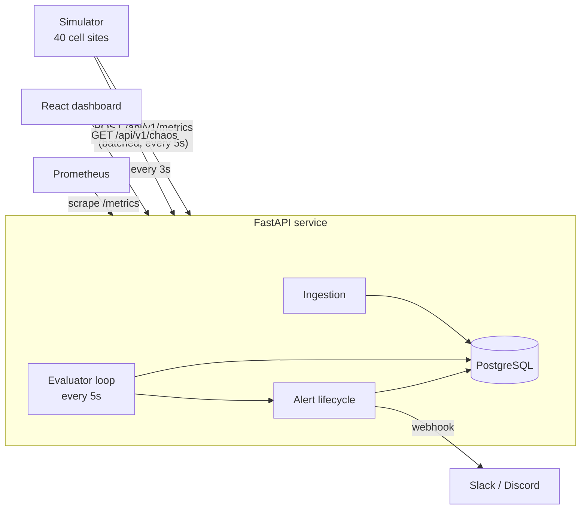
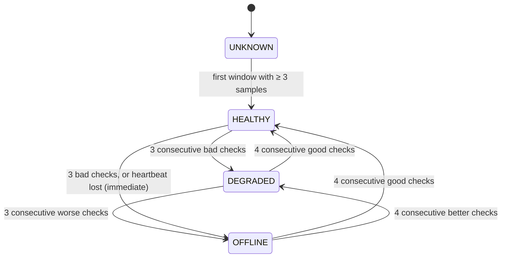

# Architecture & design notes

## System overview

**Ingestion and evaluation are decoupled.** `POST /metrics` only validates and stores samples. It never decides health, so it stays fast and a slow evaluation can't back-pressure the collectors. The evaluator runs on its own 5 s clock, aggregates each site's recent window, and writes the result.

### Data model

| Table | Purpose |
|---|---|
| `sites` | The site registry **plus its current health** (status, since, reasons, window medians, hysteresis counters). Denormalized on purpose: the dashboard lists every site with one indexed query, and hysteresis state survives a restart. |
| `metric_samples` | Raw time series, indexed on `(site_id, ts)`. Pruned after 24 h. |
| `alerts` | One row per incident: severity, state (open/resolved), reason, opened/resolved times. At most one open alert per site. |
| `status_events` | Append-only log of confirmed status transitions, written in the same transaction as the status change. One row per *transition*, not per sample, so it stays tiny. It's the history behind uptime and MTTR. |
| `chaos_faults` | Injected faults the simulator applies. The monitor never reads this table. |

### Uptime and MTTR

`sites` holds the current state; `status_events` holds how it got there. Uptime is computed by [`app/uptime.py`](backend/app/uptime.py) (pure functions) as a **time-weighted integral** over that log: the time spent in each status between transitions. It deliberately doesn't count samples, because samples stop arriving during exactly the outages being measured.

- **Availability** is the share of observed time *not* OFFLINE (the service was usable). **Healthy** is the share of time HEALTHY.
- Time before a site's first status, and time UNKNOWN, isn't scored, so a site registered an hour ago isn't judged on 23 hours of nothing.
- An **incident** is a run of unhealthy statuses: DEGRADED → OFFLINE → HEALTHY counts as one incident, matching how alerts escalate rather than re-open. Incidents belong to the window they start in; **MTTR** is the mean duration of those that also recovered.
- Each report is built with two queries regardless of fleet size: the last transition before the window (the starting status) and all transitions inside it. The fleet figure weights every site by its observed time.

## How a status is decided

Each 5 s evaluation:

1. **Window**: take the site's samples from the last 30 s.
2. **Evidence check**: fewer than 3 samples means "not enough evidence", so hold the current state.
3. **Strict-majority median**: `median_low` for latency and loss, `median_high` for availability. A breach only counts if more than half the samples show it.
4. **Classify** the medians against thresholds: HEALTHY, DEGRADED or OFFLINE, with reasons.
5. **Hysteresis**: a different verdict must repeat on consecutive checks (3 to get worse, 4 to get better) before the status changes. Consecutive "worse" verdicts accumulate even if they differ (DEGRADED then OFFLINE).
6. **Heartbeat**: no data for 30 s means OFFLINE immediately. The silence has already lasted longer than the trip delay.
7. **Transitions** drive alerts: open, escalate, de-escalate, resolve.

The classifier and the state machine (`backend/app/health.py`) are pure functions with no I/O, so every rule has a fast unit test.

---

## Interview questions

### 1. How do you distinguish a temporary fluctuation from an actual outage?

By requiring the evidence to be **widespread in time** (a majority of a window) and **persistent** (several consecutive checks), not just extreme at one moment. Five layers, each added because something got through without it:

| Layer | Stops | How I found it |
|---|---|---|
| Rolling window | judging one sample in isolation | design |
| **Median instead of mean** | a single 2000 ms spike pulling the window mean over 150 ms for 30 s | the test `test_transient_spike_raises_no_alert` failed against the first (mean-based) version |
| **Strict-majority median** | an even-sized window that is exactly half spikes averaging to ~470 ms | the simulator's `flap` fault raised an alert in the first end-to-end run |
| **Minimum samples** | a site whose *first ever* reading was a blip going straight to DEGRADED | the same end-to-end run |
| Hysteresis (3 to trip, 4 to clear) | short bursts (< 15 s) and flapping between states | design; `test_flapping_never_trips` |

**The trade-off is time-to-detect.** With these defaults a real degradation alerts after about 35 s: about 20 s for the problem to fill a majority of the window, plus 15 s of confirmation. A hard outage alerts at about 30 s. For a cell site that's a reasonable price for not paging on noise, and every knob (`WINDOW_S`, `TRIP_COUNT`, `CLEAR_COUNT`, `MIN_SAMPLES`, `STALE_AFTER_S`) is an env var, so it can be tuned per environment.

Clearing is deliberately slower than tripping (4 vs 3). The dangerous failure is an alert that resolves and re-opens every minute, so "all clear" should be harder to earn than "something's wrong".

**Next steps:** per-site baselines (alert on deviation from *this site's* normal, since 80 ms is fine for a rural LTE site and alarming downtown), multi-signal confirmation (a second independent probe), and spatial correlation (if neighbouring sites all degrade together, it's probably shared backhaul, so raise one grouped alert).

### 2. How would this system handle thousands of network sites?

**The load:** 10,000 sites reporting every 5 s is about 2,000 samples/s, and each evaluation reads about 60,000 rows (10k sites × 6 samples).

#### Measured at scale

I measured it rather than estimating it. The simulator's `SIM_EXTRA_SITES` mode adds synthetic sites, and [`scripts/benchmark.py`](scripts/benchmark.py) reads the service's own Prometheus metrics over 60 s of steady state. Final numbers, on Docker Desktop (Windows, WSL 2) with PostgreSQL 17 and the 5 s evaluation interval:

| Sites | Evaluation per tick | Ticks/min (target 12) | Ingest | `POST /metrics` | `GET /sites` (size) | `GET /health/uptime` | Deadlocks / failed ticks |
|---|---|---|---|---|---|---|---|
| 40 | 9 ms | 12 | 8 samples/s | 9 ms | 3 ms (14 KB) | 5 ms | 0 / 0 |
| 1,040 | 92 ms | 12 | 208 samples/s | 159 ms | 21 ms (380 KB) | 13 ms | 0 / 0 |
| 5,040 | 427 ms | 12 | 1,008 samples/s | 254 ms | 135 ms (1.8 MB) | 47 ms | 0 / 0 |
| 10,040 | 890 ms | 12 | 2,007 samples/s | 272 ms | 316 ms (3.7 MB) | 199 ms | 0 / 0 |

The first run didn't look like that. Load testing found two problems:

**1. The bottleneck wasn't where I expected.** The first version took **3.2 s per tick at 10,040 sites** and managed only 8 ticks a minute instead of 12, which stretches detection time by about 50%. I'd guessed the Python median calculation was the cost. Profiling one tick inside the API container showed otherwise:

| Phase (10,040 sites, original code) | Time | Share |
|---|---|---|
| Window query (60,240 rows) | 155 ms | 6.5% |
| Python grouping + medians | 80 ms | 3.4% |
| Load `Site` ORM objects | 155 ms | 6.5% |
| Classify + state machine | 110 ms | 4.7% |
| **ORM flush: 10,040 separate `UPDATE`s** | **1,875 ms** | **78.9%** |

The fix reads sites as plain rows and writes every change in **one bulk UPDATE** (a single executemany that psycopg 3 pipelines). Separately, the loop slept a full 5 s *after* each run, so the real period was 5 s plus the run time; it now sleeps only for the remainder of the interval.

**2. Faster writes exposed a deadlock.** With evaluations overlapping ingest more often, Postgres began reporting `DeadlockDetected`. Ingest updated `sites.last_seen_at` for each batch while the evaluator updated every site, and the two locked overlapping rows **in different orders**. Postgres aborted the ingest, the simulator's batches failed, and within 30 s every site went silent and was marked OFFLINE. The fix is a **single global lock order**: both writers update `sites` in ascending `id` order. Ingest also stopped doing a read-modify-write on `last_seen_at`; one SQL `UPDATE ... CASE` only ever moves it forward, which closes a concurrent-batch race as well.

Net result at 10,040 sites: **3,186 ms → 890 ms per tick (3.6× faster)**, a full 12 ticks per minute, and no deadlocks or lost batches.

**What the numbers say comes next:** the evaluator now uses under 20% of its 5 s budget at 10k sites. The next bottleneck is the **dashboard**: every viewer re-downloads the full 3.7 MB site list every 3 seconds. That's why the first two items below are where I'd go next.

What's already in place:
- Batched ingestion: one request and one transaction per collector tick, not per sample.
- Ingestion doesn't evaluate, so ingest throughput and evaluation cost scale independently.
- A composite `(site_id, ts)` index, 24 h retention, and a denormalized current-status row, so reads never scan history.
- The dashboard's summary endpoint is a single `GROUP BY`.

What I'd change, roughly in order (re-ordered by what the measurements showed):
1. **Dashboard**: push status *changes* over SSE or WebSocket, or at least use `ETag`s so an unchanged poll costs a `304`, instead of re-sending the whole 3.7 MB site list every 3 s. Add server-side filtering and pagination, and marker clustering on the map.
2. **Write less per tick**: the evaluator rewrites every site's window medians on every tick. Writing only rows whose *status* changed, and serving live medians from the window query or a cache, would cut the bulk write to a handful of rows.
3. **Run the evaluator on its own**, and shard it by `hash(site_id) % N`, with each worker owning a slice of sites, coordinated with Postgres advisory locks or a lease. *Today the evaluator runs inside the API process, so running two API replicas would evaluate twice and open duplicate alerts. Splitting it into its own singleton or sharded worker is the first change before scaling out.*
4. **Time-series storage**: TimescaleDB hypertables (or native partitioning by day), so retention is `DROP PARTITION` instead of `DELETE`. A continuous aggregate can pre-compute per-window stats.
5. **Queue in front of ingestion** (Kafka or Kinesis), so collectors never block on the database and the system can absorb bursts and replay.

### 3. What happens if the monitoring service itself goes down?

The worst failure for a monitor is **silently showing "all green" while it's dead**. Here's what's handled:

| Failure | Behaviour |
|---|---|
| API process dies | Docker `restart: unless-stopped` and a `/readyz` healthcheck restart it. The dashboard shows a red **"Monitoring API unreachable"** banner and keeps the last data visible, labelled as stale. |
| Evaluator loop stalls or errors (API still up) | `/api/v1/health/summary` reports `evaluator.running = false` and the last error. The dashboard shows **"Health evaluator is not running — statuses are frozen."** |
| Need to page someone even if the UI isn't open | `/metrics` exposes `network_pulse_evaluation_last_success_timestamp_seconds`. An external Prometheus alerts on `time() - that > 30` or `absent(up{job="network-pulse"})`, a dead man's switch that doesn't depend on this service. |
| Restart loses state? | No. Status, hysteresis counters and open alerts live in Postgres, so a restart picks up mid-incident without re-alerting. |
| **Restart after a long outage** | Initially, every site's `last_seen_at` was stale on restart, so the first evaluation marked the **whole fleet OFFLINE**: an alert storm caused by the monitor's own downtime. Fixed: silence is measured from `max(last_seen_at, evaluator_start)`, so sites are only blamed for silence we were actually listening for (`test_monitor_restart_does_not_mark_every_site_offline`). |
| Database down | `/readyz` returns 503, ingestion fails, and the evaluator records the error and keeps retrying. Collectors should buffer and retry (the simulator retries every tick). |
| Webhook endpoint down | Delivery runs on a background thread pool with a 3 s timeout. Failures are logged and counted (`network_pulse_alert_notifications_total{result="failed"}`) and never block evaluation. |

**Next steps:** run two evaluators with leader election for high availability; have collectors buffer to disk during an outage and backfill timestamps; and treat "most of the fleet went stale at once" as a *pipeline* incident (one alert) rather than N site outages.

### 4. How would you reduce false-positive alerts?

What the system already does:
- Everything in Q1: median, strict majority, minimum samples, asymmetric hysteresis.
- **Alerts fire on confirmed state transitions, never on raw samples**, and there is at most one open alert per site. DEGRADED → OFFLINE escalates the same alert instead of opening a second.
- **Restart suppression** (Q3) prevents the monitor's own downtime from becoming N false outages.
- **Testing false positives is first-class**: the `flap` chaos fault is a one-click live demo that a noisy site *doesn't* alert, and each false positive found during development has a regression test.

Next steps:
- **Per-site, time-of-day baselines**: thresholds as "N× this site's p95 for this hour" rather than a global 150 ms.
- **Alert grouping and correlation**: one alert for "West Houston: 6 sites degraded" instead of six, and suppress downstream sites when their upstream aggregation point is down.
- **Maintenance windows and silences**: planned work shouldn't page.
- **Measure it**: track alert precision (alerts that needed action ÷ all alerts) and time-to-detect as SLOs, and tune the knobs against both, since they trade off directly.

---

## Other trade-offs and known gaps

- **Schema migrations**: tables are created with `create_all` on startup. A real deployment would use Alembic.
- **Auth**: ingestion and chaos endpoints are open. Production would need collector API keys, and the chaos API would be disabled or restricted by role.
- **Polling vs push**: the dashboard polls every 3 s. That's simple and robust for ~100 sites; at fleet scale, SSE deltas (see Q2).
- **Simulated data**: the simulator models jitter, blips, congestion and interference, not real RAN KPIs (RSRP, call drops, handover failures). The ingestion schema is the extension point for those.
